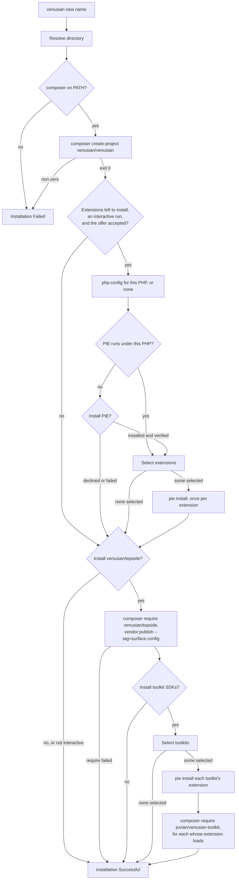

# Venusian Installer

<a href="https://github.com/VenusianPHP/installer/actions"></a>
<a href="https://packagist.org/packages/venusian/installer"></a>
<a href="https://packagist.org/packages/venusian/installer"></a>
<a href="https://packagist.org/packages/venusian/installer"></a>

## Introduction

The Venusian installer creates new [Venusian PHP](https://venusian.projectsaturnstudios.com) applications from the `venusian/venusian` skeleton.

## Requirements

- PHP 8.4, 8.5 or 8.6
- [Composer](https://getcomposer.org/download/) on your `PATH`
- For the optional PHP extensions: a C compiler and your PHP's development files (`phpize`, `php-config`). [PIE](https://github.com/php/pie) does the building; the installer offers to install it when it is missing.

## Installation

```bash
composer global require venusian/installer
```

Make sure Composer's global `vendor/bin` directory is on your `PATH` so the `venusian` command is available.

## Usage

```bash
venusian new example-app
```

`name` may be a directory name (created under the current directory), `.` for the current directory, or an absolute path. The installer finds `composer` and runs:

```bash
composer create-project venusian/venusian:^0.11.1 <directory> --remove-vcs --prefer-dist
```

The skeleton's Composer hooks then copy `.env.example` to `.env`, write an `APP_KEY`, create `database/database.sqlite`, and discover packages. Run your first sketch:

```bash
cd example-app
php rocket hello-world
```

`new` exits 0 once the application exists, and 1 when it could not be created.

### One PHP for everything

The installer does all its work with the PHP binary that runs it: Composer, PIE, and the application's own `computer` console are all started with that binary, whatever PHP is first on your `PATH`. Composer then resolves your application's platform requirements for that PHP, and extensions are built for it with its own `php-config`. To set up an application for a PHP other than the one on your `PATH`, run the installer with it:

```bash
/opt/homebrew/opt/php@8.4-zts/bin/php "$(command -v venusian)" new example-app
```

### PHP extensions

Once the application exists, an interactive run offers Venusian's first-party PHP extensions:

| Extension | What it gives the framework | Offered on |
|---|---|---|
| [epoll](https://packagist.org/packages/php-io-extensions/epoll) | event loop waiting on Linux | Linux |
| [kqueue](https://packagist.org/packages/php-io-extensions/kqueue) | event loop waiting on macOS | macOS |
| [multicurl](https://packagist.org/packages/php-io-extensions/multicurl) | HTTP requests that run on the event loop | everywhere but Windows |

The list shows all three. One that belongs to another operating system, or that your PHP already loads, is a disabled row with its reason:

```
 ┌ Extensions to install ───────────────────────────────────────┐
 │   – epoll — event loop waiting on Linux (Linux only)         │
 │ › ◼ kqueue — event loop waiting on macOS                     │
 │   ◼ multicurl — HTTP requests that run on the event loop     │
 └──────────────────────────────────────────────────────────────┘
```

Each selected extension is built and installed by [PIE](https://github.com/php/pie), run by the PHP binary that is running the installer, so the extensions land in that PHP:

```bash
php pie install php-io-extensions/kqueue:^0.11 --with-php-config=/path/to/that/php-config
```

- **php-config:** the installer finds the one that belongs to the running PHP, by its `--php-binary`, or by its prefix, version and thread safety when it names no binary (Homebrew's `php@8.4-zts` does that). With none, PIE builds for the PHP running it and offers to install PHP's development files.
- **PIE missing:** the installer asks before downloading `pie.phar` from the [PIE releases](https://github.com/php/pie/releases) to `~/.local/bin/pie`, then has PIE verify its own release attestation. A copy that fails is removed.
- **sudo:** PIE asks for your password itself when PHP's extension directory is not writable.
- **Failures:** a failed build is reported in the closing summary and does not undo the application. The framework runs without these extensions.
- Declining, or a non-interactive run, skips the step.

### Topside and toolkit SDKs

Next, the installer asks whether to install [Venusian Topside](https://github.com/VenusianPHP/topside), the visual output framework. Yes runs, in the application:

```bash
composer require venusian/topside:^0.11
php computer vendor:publish --tag=surface-config
```

which publishes `config/toolkits.php` and `config/main.presentation.php`.

Then it asks whether to install toolkit SDKs. Yes shows the four toolkits Topside draws with, nothing selected; selecting none is fine:

| Toolkit | Extension | Adapter | Offered on |
|---|---|---|---|
| appkit | [appkit](https://packagist.org/packages/php-io-extensions/appkit) | `jovian/venusian-appkit` | macOS |
| gtk | [gtk](https://packagist.org/packages/php-io-extensions/gtk) (and appkit on macOS) | `jovian/venusian-gtk` | Linux, macOS |
| qt | [qt](https://packagist.org/packages/php-io-extensions/qt) | `jovian/venusian-qt` | Linux, macOS |
| raven | [raven](https://packagist.org/packages/php-io-extensions/raven) | `jovian/venusian-raven` | Linux, macOS |

For each toolkit selected, the installer builds its extension through PIE, exactly as above, skipping one your PHP already loads, then runs `composer require jovian/venusian-<toolkit>:^0.11`. An adapter is required only once its extension loads, since Composer refuses it otherwise; the summary says which toolkits were installed and why any were not. Some toolkits build against system libraries (GTK 4, Qt 6); PIE reports what is missing.



### Installing extensions later

`venusian install:ext` installs the framework's extensions, and `venusian install:toolkit-ext` the toolkits' extensions, at any time, into the PHP binary running `venusian`:

```bash
venusian install:ext                  # choose epoll, kqueue or multicurl from the list
venusian install:ext multicurl        # install that one
venusian install:toolkit-ext          # choose appkit, gtk, qt or raven from the list
venusian install:toolkit-ext qt       # install that one
```

The list shows every extension of the command. A row is disabled, with its reason, when the extension belongs to another operating system (appkit is macOS only), when your PHP already loads it, or when Packagist has neither a 0.11 release nor a 0.11 development branch of it. Nothing starts selected. An extension with no tagged 0.11 release yet installs from its 0.11 development branch (`0.11.x-dev`); its row and its outcome say so.

These commands install the extension only, not a toolkit's adapter: add that to an application with `composer require jovian/venusian-<toolkit>`.

Without a terminal, name the extension: `venusian install:ext multicurl --no-interaction`. Each command exits 0 when everything asked for is installed or there was nothing to install, and 1 otherwise.

### Updates

On each interactive run the installer checks Packagist, at most once a day, for a newer `venusian/installer`. When one exists it offers to run `composer global require` for it and re-runs your command on the new version. Non-interactive runs skip the check; to skip it in an interactive shell:

```bash
VENUSIAN_INSTALLER_NO_UPDATE_CHECK=1 venusian new example-app
```

## Official Documentation

Documentation for installing Venusian can be found on the [Venusian website](https://venusian.projectsaturnstudios.com/docs#creating-a-venusian-php-project).

## Contributing

Thank you for considering contributing to the Installer! The contribution guide can be found in the [Venusian documentation](https://venusian.projectsaturnstudios.com/docs/contributions).

## Code of Conduct

In order to ensure that the Venusian community is welcoming to all, please review and abide by the [Code of Conduct](https://venusian.projectsaturnstudios.com/docs/contributions#code-of-conduct).

## Security Vulnerabilities

Please review [our security policy](SECURITY.md) on how to report security vulnerabilities.

## License

Venusian Installer is open-sourced software licensed under the [MIT license](LICENSE).
